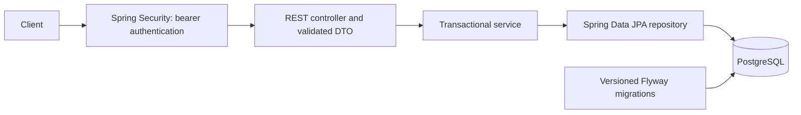

# TaskFlow

TaskFlow is a full-stack project management demo with a responsive web interface
and a Java/Spring Boot API. It demonstrates layered REST APIs, relational
persistence, transactions, validation, authentication, and automated testing.

The project can run locally or be built as a Docker image. Project data is scoped
to its owner. Projects created before ownership was added remain unassigned and
are hidden from users after migration.

## Run the demo

The application serves the TaskFlow web interface at `/` and Swagger at
`/swagger-ui/index.html`. A free demo deployment uses Render for the Docker web
service and Neon for PostgreSQL. Keep database credentials private. The free web
service sleeps after inactivity, so its first request can take about a minute.

## Implemented functionality

- Project CRUD with bounded pagination.
- Task CRUD within Projects, status changes, priority updates, and status/priority filters.
- User registration with normalized unique emails and salted bcrypt password hashes.
- Login with signed, 15-minute JWT bearer tokens; protected Project and Task endpoints.
- Project ownership checks for Project and Task access.
- Responsive web UI for account creation, project tracking, and task updates.
- DTO validation and Problem Details responses for expected request errors.
- Flyway migrations, PostgreSQL constraints, and transactional persistence.
- OpenAPI documentation, Swagger UI, and Actuator health.

## Technology and architecture

Java 21, Spring Boot 4.1.1, Maven Wrapper, Spring MVC, Spring Data JPA/Hibernate,
PostgreSQL 17, Flyway, Spring Security, Springdoc OpenAPI, Docker Compose,
JUnit, AssertJ, Mockito, and MockMvc.



Controllers handle HTTP; services own transaction boundaries and DTO mapping;
repositories handle persistence. Hibernate validates the migrated schema with
`ddl-auto=validate`. Task-to-Project relationships are lazy. Deleting a Project
cascades to its Tasks; deleting a Task preserves its Project.

JWTs contain User ID, issuer, audience, and timestamps. Spring validates signatures
and claims. JWTs are signed, not encrypted. Passwords and hashes are never token
claims. Login and registration are public; Project and Task APIs require a token.

## Run locally

Prerequisites: Java 21, Docker with Compose, and OpenSSL for local signing-key
creation. Maven is downloaded by the wrapper; no separate Maven install is needed.

```sh
git clone https://github.com/hoanghuyho2k/TaskFlow.git
cd TaskFlow
docker compose up -d --wait postgres
export JWT_SECRET="$(openssl rand -base64 32)"
./mvnw spring-boot:run
```

Keep `JWT_SECRET` private. It must encode at least 32 random bytes. Keep it stable
across restarts if existing tokens should remain valid; changing it invalidates them.
There is no runtime signing-key default. Never use the committed test-only key for
a running deployment. Do not activate the `test` profile outside automated tests.

Compose runs PostgreSQL; Java runs on the host. PostgreSQL binds only to
`127.0.0.1:5432` and uses a named volume. `taskflow` / `taskflow_local` are public,
non-sensitive local development credentials, not production secrets. Export
`DB_URL`, `DB_USERNAME`, and `DB_PASSWORD` to override the application connection.
Spring does not automatically load `.env` files. Compose initialization credentials
apply only to an empty volume; changing them does not change existing passwords.

In another terminal:

```sh
curl -i http://localhost:8080/actuator/health
```

Expect 200 with `status: UP`. Stop Java with Ctrl+C. Stop PostgreSQL with
`docker compose down`; adding `-v` intentionally deletes its data.

### Run the containerized app

```sh
export JWT_SECRET="$(openssl rand -base64 32)"
docker compose --profile demo up --build -d
```

Open http://localhost:8080. The demo profile uses the local Compose database
credentials described above. For a hosted deployment, configure `DB_URL`,
`DB_USERNAME`, `DB_PASSWORD`, and a stable Base64 `JWT_SECRET` in the host’s
secret manager; use a managed PostgreSQL service and enable HTTPS at the host.
The app container listens on port 8080 and runs as a non-root user.

The GitHub Actions workflow is configured to run `./mvnw verify` and build the
Docker image on pushes to `main` and on pull requests.

### Deploy the free demo

1. Create a PostgreSQL project on [Neon](https://neon.com/) and copy its direct
   connection details. Select a region near Render's Singapore region if
   available.
2. In Render, create a Blueprint from this repository and select `render.yaml`.
   Render creates the free Docker web service and generates a stable `JWT_SECRET`.
3. In the Render service's Environment settings, set `DB_URL` to the Neon
   connection URL, changing its scheme from `postgresql://` to
   `jdbc:postgresql://` and retaining `?sslmode=require`. Set `DB_USERNAME` and
   `DB_PASSWORD` from the same Neon connection details. Do not commit these
   values to GitHub.
4. Save the environment values and redeploy. Flyway applies the schema
   migrations on startup. Wait for `/actuator/health` to report `UP`, then open
   the service's `onrender.com` URL and register a demo account.

The Render Blueprint includes the public health check, free plan, and service
region. The Render free filesystem is temporary, so all persistent application
data must stay in Neon. Render's free web service may sleep and cold-start; Neon
also enforces free-plan usage limits. Check the providers' current limits before
sharing the demo widely.

## Explore the API

- Swagger UI: http://localhost:8080/swagger-ui/index.html
- OpenAPI JSON: http://localhost:8080/v3/api-docs

Register a local example account (choose a different email if it already exists):

```sh
curl -i -X POST http://localhost:8080/api/auth/register \
  -H 'Content-Type: application/json' \
  -d '{"email":"learner@example.com","displayName":"Learner","password":"Example-password-123!"}'
curl -s -X POST http://localhost:8080/api/auth/login \
  -H 'Content-Type: application/json' \
  -d '{"email":"learner@example.com","password":"Example-password-123!"}'
```

Copy only the `accessToken` value into Swagger UI's **Authorize** dialog, without
quotes or JSON field names. Swagger adds `Bearer`. For curl, use
`-H 'Authorization: Bearer YOUR_ACCESS_TOKEN'` on Project and Task requests.
These example account credentials are documentation examples, not deployed credentials.

| Method | Path | Behavior |
| --- | --- | --- |
| POST | `/api/auth/register` | Register; 201, invalid fields 400, duplicate email 409 |
| POST | `/api/auth/login` | Obtain token; invalid credentials 401 |
| GET / POST | `/api/projects` | Paginated listing / creation |
| GET / PUT / DELETE | `/api/projects/{id}` | Retrieve / replace details / delete Project and Tasks |
| GET / POST | `/api/projects/{projectId}/tasks` | Filtered paginated listing / creation |
| GET / PUT / DELETE | `/api/tasks/{id}` | Retrieve / replace details and priority / delete |
| PATCH | `/api/tasks/{id}/status` | Change status |

Use actual IDs returned by the API. Project IDs and Task IDs are separate.
POST creates a new resource on each successful request. Creation returns 201,
deletion 204, and other successful domain operations 200. Missing resources return
404; invalid requests 400; missing/invalid bearer authentication 401.

Pages start at zero; size defaults to 20 and is limited to 100. Task listing accepts
`status` and `priority`, combined with AND before pagination. Statuses are `TODO`,
`IN_PROGRESS`, `DONE`; priorities are `LOW`, `MEDIUM`, `HIGH`. New Tasks default to
TODO/MEDIUM. All status transitions, including reopening, are allowed.
PUT clears an omitted description; Task PUT requires title and priority and preserves
status. Swagger requests mutate the real local database.

Further explanations: [registration](docs/registration.md) and
[JWT authentication](docs/authentication.md).

## Tests

With PostgreSQL running:

```sh
./mvnw clean test
./mvnw verify
```

The suite currently has 96 tests covering persistence, constraints, CRUD, validation,
filtering, password handling, login, invalid/tampered/expired tokens, and OpenAPI.
Integration-style tests use the local Compose database and roll back test writes;
ID sequences can still advance. The test profile supplies a clearly labelled
test-only signing key. MockMvc domain tests use authenticated test callers; dedicated
login tests exercise real JWT validation through the security filter chain.
The CI workflow runs the suite against a PostgreSQL 17 service. Local integration
tests use the Compose database and roll back test writes; do not run them against
production.

## Project structure

```text
src/main/java/com/huyho/taskflow/
  auth/       Registration, login, DTOs, and password validation
  common/     Central API exception handling
  config/     Security, JWT, password encoding, and OpenAPI
  project/    Project entity, repository, service, controller, and DTOs
  task/       Task entity, enums, repository, services, controllers, and DTOs
  user/       User entity and repository
src/main/resources/
  application.properties
  db/migration/  Versioned SQL migrations
src/test/        API, security, and persistence tests
compose.yaml     Local PostgreSQL
docs/           Authentication guides
```

## Current limitations and roadmap

- Next: Project membership and Task assignment.
- Then: isolated PostgreSQL tests with Testcontainers.
- Later: caching with Redis, domain events with Kafka, retries/idempotency,
  notifications/activity, and production deployment hardening.
- No refresh tokens, immediate token revocation, or per-request deleted-User check yet.
- Login rate limiting, production TLS/secrets handling, and observability need deployment work.
- Concurrent updates use last-write-wins; optimistic locking is not implemented.

Redis, Kafka, GitHub Actions, and AWS are roadmap items, not implemented features.

## Troubleshooting

- Port 8080 occupied: stop the old server before restarting, or use `SERVER_PORT=8081`.
- Missing/invalid `JWT_SECRET`: export a Base64-encoded random key before startup.
- 401 in Swagger: paste only a fresh token and reauthorize after changing the signing key.
- 404: verify the resource exists and use a Task ID for Task routes, not a Project ID.
- Database connection failure: check `docker compose ps` and `docker compose logs postgres`.
- Migration checksum mismatch: restore the applied migration and add a new version.
- Schema mismatch: compare mappings and migration SQL; do not hide it with `ddl-auto=update`.
